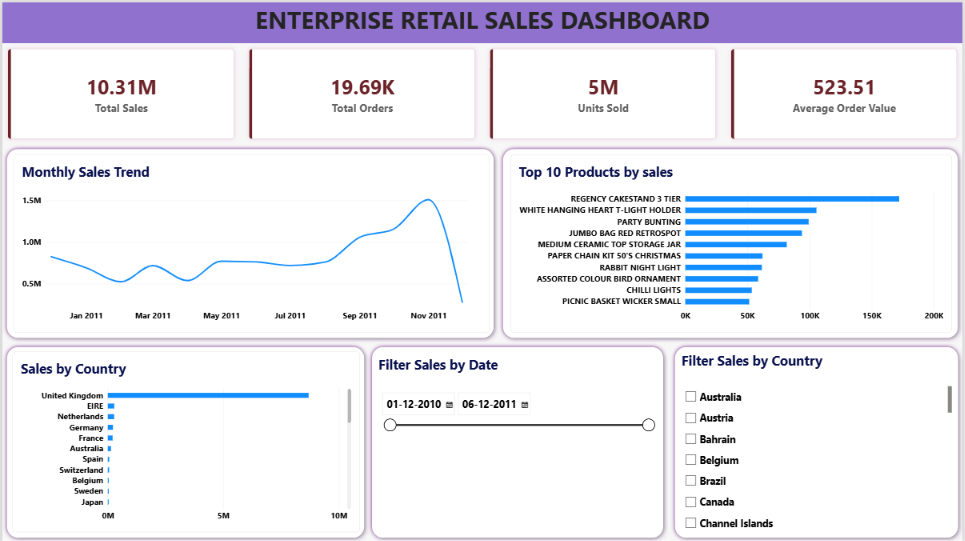

# Enterprise Retail Data Warehouse & Sales Dashboard

An end-to-end retail data project using **PostgreSQL** and **SQL** to build a star schema data warehouse from raw transaction data, paired with an interactive **Power BI** dashboard for sales, product, and country analysis.

---

## 🛠️ Tech Stack

- **Database & Data Warehouse:** PostgreSQL
- **Querying, Cleaning & Validation:** SQL
- **Data Visualization:** Microsoft Power BI

---

## 🏗️ Data Warehouse Architecture

Raw data flows through three layers:

1. **Staging** (`stg_online_retail`): raw data as loaded, **541,909 rows**.
2. **Clean** (`clean_online_retail`): data after cleaning rules, **530,100 rows** (11,809 removed).
3. **Star schema:** one fact table and four dimension tables, linked by primary and foreign keys.

| Table | Type | Rows |
|---|---|---|
| `fact_sales` | Fact (one row per invoice line) | 530,100 |
| `dim_customer` | Dimension | 4,339 |
| `dim_product` | Dimension | 3,921 |
| `dim_date` | Dimension | 374 |
| `dim_country` | Dimension | 38 |

---

## 🧹 Data Cleaning & Validation

Rows removed from staging (11,809 in total):

- Cancelled invoices (invoice numbers starting with "C"): 9,288
- Zero or negative quantity: 10,624
- Zero or negative unit price: 2,521
- Missing product description: 1,454

Some rows match more than one rule, so these counts overlap.

The checks in `sql_scripts/03_validation_checks.sql` confirm that:

- Row counts reconcile across the staging, clean, and fact layers.
- No invalid quantities, prices, or cancelled invoices remain in the clean layer.
- Every fact row matches a row in each dimension, so there are no orphan keys.
- `total_sales` equals `quantity × unit_price` on every row.

**Known limitations**

- 132,220 clean rows (about 25%) have no `customer_id`. They are kept and mapped to an "unknown customer" row (`customer_key = 0`).
- 5,226 duplicate rows remain in the clean data. Identical lines can be genuine repeat items on the same invoice, so they were not removed.
- Non-product items such as POSTAGE, DOTCOM POSTAGE, and Manual are in the fact table. The dashboard's Top 10 Products chart excludes them.

---

## 📊 Dashboard Overview

Headline numbers for the full data period (1 December 2010 to 9 December 2011):

| Metric | Value |
|---|---|
| Total Sales | 10.67M |
| Total Orders | 19,960 |
| Units Sold | 5.59M |
| Average Order Value | 534.40 |

**Visuals**
- **Monthly Sales Trend:** sales by month. December 2011 is a partial month, so the drop at the end of the line is not a real decline.
- **Top 10 Products by Sales:** best-selling products, excluding postage and manual adjustments.
- **Sales by Country:** sales broken down by country.
- **Slicers:** filter by date range and by country.

---

## 🔍 Key Insights

- Sales rise through 2011 and peak in **November 2011** at about 1.5M.
- The **United Kingdom** accounts for the vast majority of sales.
- **Regency Cakestand 3 Tier** is the top-selling product.

---

## 📂 Repository Structure

- `sql_scripts/01_schema.sql` – table definitions for all layers
- `sql_scripts/02_cleaning_rules.sql` – cleaning rules from staging to clean
- `sql_scripts/03_validation_checks.sql` – data validation queries with expected results
- `Enterprise_Retail_Data_Warehouse.zip` – full PostgreSQL database dump (compressed, too large to upload directly)
- `Enterprise Retail Sales Dashboard.pbix` – Power BI report file
- `Dashboard.png` – dashboard preview
- `Enterprise_Retail_Data_Warehouse_Project.pdf` – project documentation

---

## 🚀 How to Run This Project

1. **Restore the database:** unzip `Enterprise_Retail_Data_Warehouse.zip`, create an empty PostgreSQL database, and run the `.sql` file inside it with `psql`.
2. **Run the checks:** run `sql_scripts/03_validation_checks.sql` and compare the results with the expected values in the comments.
3. **Open the dashboard:** open `Enterprise Retail Sales Dashboard.pbix` in Power BI Desktop.
4. **Refresh the data:** under **Transform data → Data source settings**, update the PostgreSQL connection details, then click **Refresh**.

---

## 📌 Data Source

[Name the dataset and add a link here, if it is a public one.]

---

## 🔮 Possible Next Steps

- Decide whether to remove exact duplicate rows, and document the impact on the totals.
- Add a product category breakdown.
- Add profit analysis if cost data becomes available.
- Add year-over-year comparisons once a full second year of data is available.
